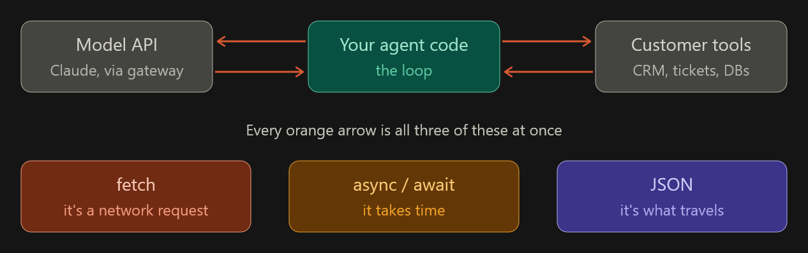

libraries:
- zod : https://www.totaltypescript.com/tutorials/zod/zod-section/number
- mcp server : import { McpServer } from "@modelcontextprotocol/sdk/server/mcp.js";

stuff to learn
- async / await : calling an LLM takes seconds; `await` lets you wait without freezing everything, and `Promise.all` lets you fire several calls concurrently instead of one after another

- promises : every SDK call and `fetch` returns one; async/await is just nicer syntax on top, so you need to know what's underneath when debugging

- arrays : messages, tool calls and content blocks all come back as arrays; `map` / `filter` / `find` are how you pull out the bits you need

- objects : every request and response is a JSON object; reading nested fields (`res.content[0].text`) and building request bodies is most of the work

- error handling : networks fail, APIs rate-limit (429), models time out; `try / catch` decides whether your agent retries, falls back or crashes

- http : status codes, headers and methods tell you what went wrong (401 = bad key, 429 = slow down, 500 = their side)

- rest apis : the Claude API, Bifrost and Proxmox are all REST; knowing endpoint + method + JSON body lets you talk to any of them

llm
- stream responses : users see tokens as they arrive instead of staring at a blank screen for 20s; also lets you stop early

- expose tools : tools are how the model *acts* (read files, query Proxmox); without them it can only talk

- handle failures : retries with backoff, timeouts and fallbacks keep an agent running when one call fails

- authentication and guardrails : API keys must stay secret, and guardrails (like `guard.ts`, PII redaction) stop the agent doing or leaking something it shouldn't

80% of agent code:
- promises, async / await
- network requests
- javascript.info. focus on promises, async / await, network requests chapters. 

